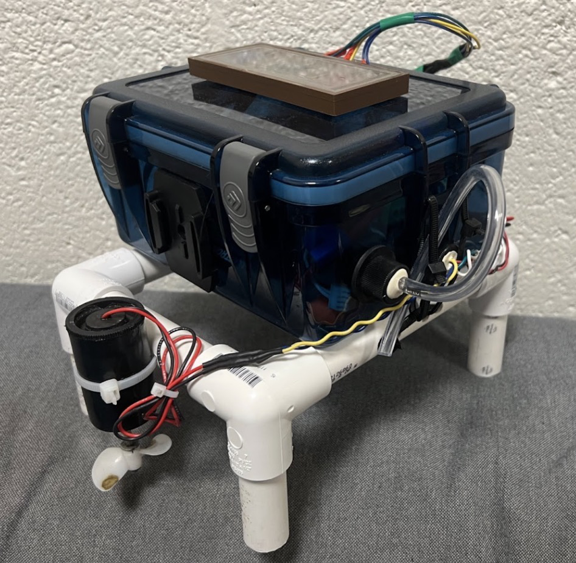
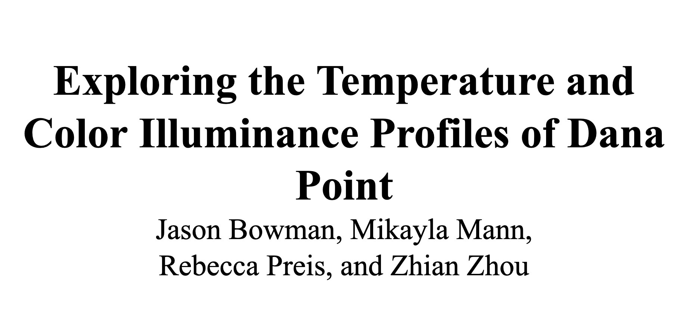
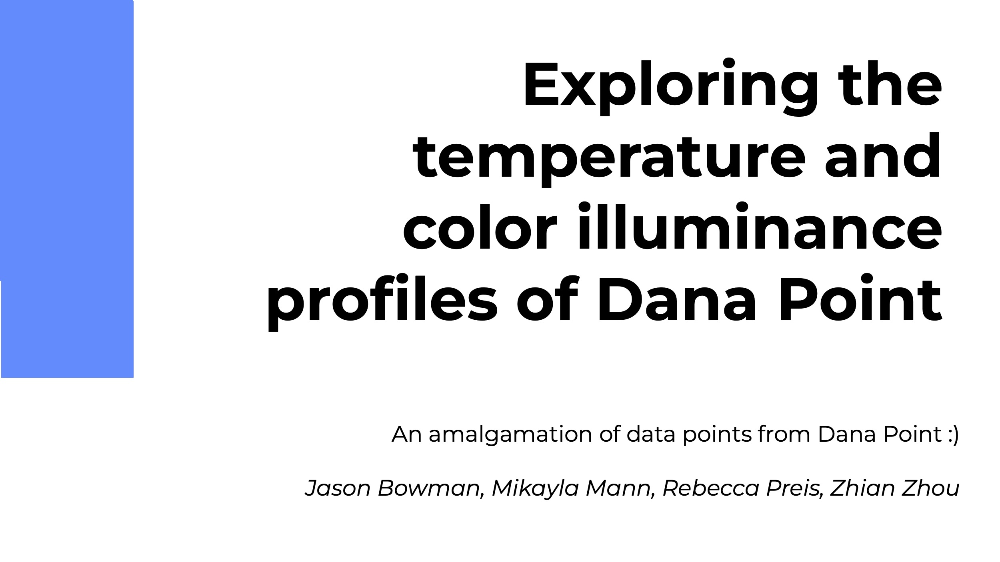
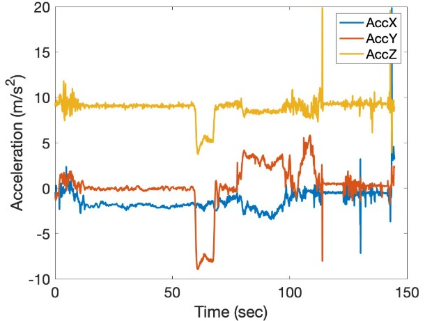
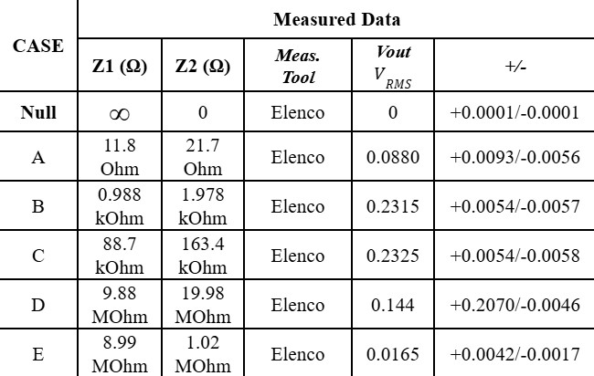
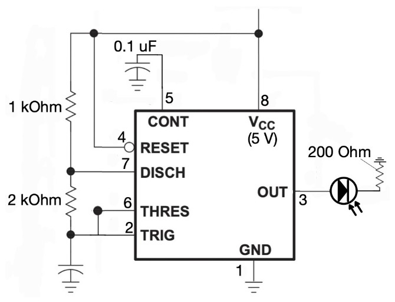
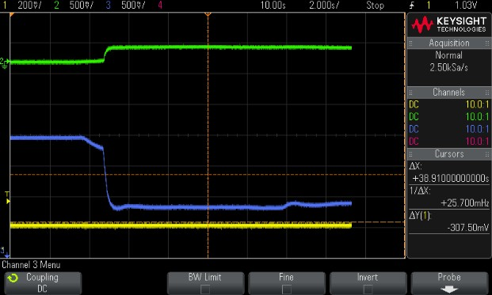
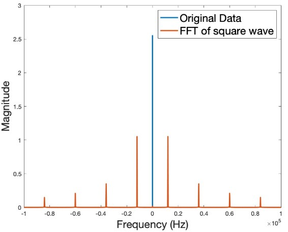
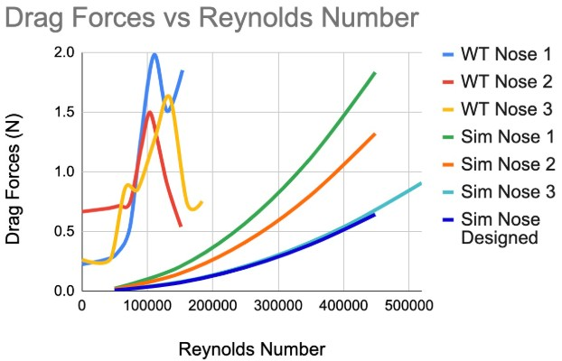

E80, a course in the Harvey Mudd College Engineering Core program where we first worked in pairs to complete labs, building foundational knowledge. We then formed teams of four for a final project, developing an autonomous underwater robot with a focus on sensor integration. Our project specifically investigated light intensity comparisons between GoPro footage as a baseline and photodiode sensor integrations.

Working as a team, we successfully developed the electrical, mechanical, and software integrations needed to extract accurate RGB illuminance data at depths of up to 5 meters in Dana Point, CA, using photodiodes. We then compared this data to the RGB-decomposed version of the GoPro footage. For more specifics please see the Final Report linked at the bottom of the page.

 (Me) - [Rebecca Preis](https://www.linkedin.com/in/rebecca-preis/) - [Mikayla Mann](https://www.linkedin.com/in/mikayla-mann/) - [Zhian Zhou](https://www.linkedin.com/in/zhian-zhou-14ba8b325/)](images/team.jpeg)

This team made the experience truly memorable, and we still check in on each other periodically, reminiscing about our days in E80. We learned a lot, faced challenges, took turns leading and following, stressed over obstacles, and celebrated our successes. I couldn’t have asked for a better team.

Please see the links below for the final details of our project, including our final presentation and report. Also included are the lab reports, which I completed individually after working with a partner during the pre-project lab work. This course took place during my sophomore year of college and showcases my growth in both technical skills and technical writing.

---

# Final Results

  
Final Report

  

  
Final Presentation

  

  
Real Time Data Video

  <video width="100%" controls>
    <source src="videos/Flub.mp4" type="video/mp4">
    Your browser does not support the video tag.
  </video>

  
Deployment

  <video width="100%" controls>
    <source src="videos/Flub_shore.MOV" type="video/mp4">
    Your browser does not support the video tag.
  </video>

---

# Lab Reports

  
Lab 1 Report - Going Autonomous

  

  
Lab 2 Report - BEM

  

  
Lab 3 Report - Turbidity Using Photodiodes and 555-Timer

  

  
Lab 4 Report - Temperature

  

  
Lab 5 Report - Acoustics

  

  
Lab 6 - Fluid Dynamics Technical Memorandum

  

