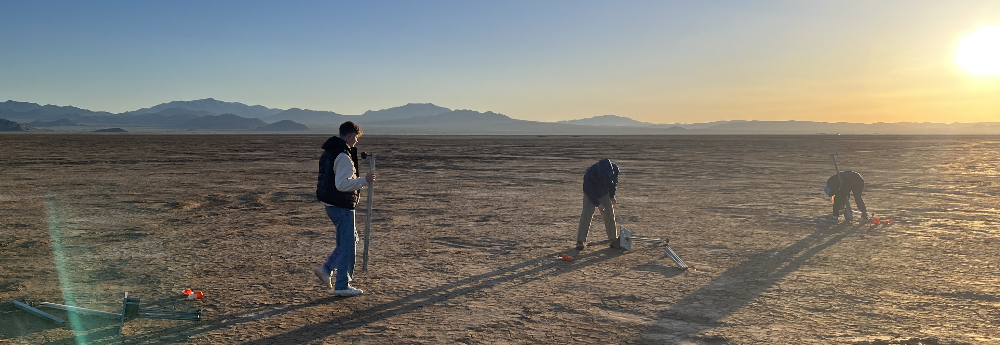
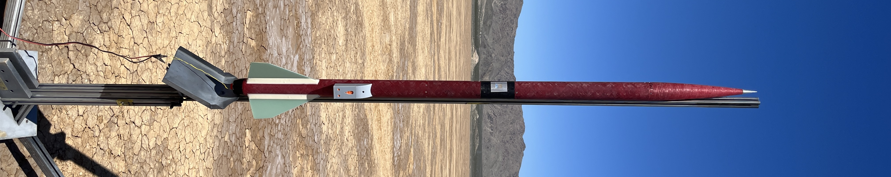

    

# About

This post highlights my and [Jordan Stone's](https://www.linkedin.com/in/jordan-stone-844a4b1b8/) final project in E178: [High Power Rocketry](https://pages.hmc.edu/spjut/AdvRoc/index.md.html), taught by [Prof. Erik Spjut](https://www.hmc.edu/about/news/experts/erik-spjut/). This course covered the modeling and design of a stable and reliable high-power rocket, along with construction techniques such as basic machining and the use of composite epoxies for joints and fillets. We also conducted analysis of flight data, sensor verification, and, in our case, implemented active roll control with live data acquisition and a PID feedback loop.

# Project Ideation

Our project idea was sparked by reading about a previously attempted project titled *"Gyro Stabilized,"* where a team attempted to stabilize the rocket's rotation using the inherent gyroscopic torque to passively stabilize the rocket. This project did not work well and resulted in the comment that it *"Got the gyro to spin up, but it didn't seem to have much effect."* – [HPR Website under "Final Project"](https://pages.hmc.edu/spjut/AdvRoc/finalproject.md.html)

Given Jordan's and my prior experience with control systems, embedded electronics, and mechanical design, we saw a clear path to an active control system using a brushless drone motor with a steel flywheel attached.

# Proposal

Like any good engineering project, there was a proposal stage. The simulations, calculations, CAD, and BOMs were developed to ensure that the project was feasible within the budget, timeframe, and the laws of physics.

Firstly, the electrical components must be selected. This system is required to be able to read magnetometer data from the Teensy 4.0 (in this case over UART), store…

<!-- NOTE: Expand this section after reviewing all of the code again -->

# Project Design

All design and implementation, apart from the build instructions and the pre-installed Teensy 4.0 MCU provided by Prof. Spjut, was done by Jason and Jordan. The main effort of the mechanical design focused on the support structure that would hold all the electronics inside the avionics bay of the rocket. The digital design was primarily concerned with communication between an Adafruit Arduino QT Py and a Teensy 4.0, as well as saving data onto an SD card. The systems design was straightforward and used simple yet proven control calibration techniques to ensure the desired function.

## Digital Design

## Systems Design

## Mechanical Design

Small dimensional changes to the original MadCow rocket build were required to fit everything into the avionics section of the rocket. Notably, a slight 1.5" extension of the avionics bay was needed to make this happen.

Aside from that, the majority of the mechanical design was focused on the avionics support structure itself. As seen below:

---

## Launch Day

---

<!-- Draft Notes: Keep for later editing
Structure:
- Intro / about
- Initial thoughts and ideas
- Why we chose what we wanted to
- What rocket we used
- Electronics
- Mechanical design
- Flight day
- Final presentation / paper

Bringing an idea into fruition, in my experience, typically comes with extra nick nacks and trinkets than I initially imagine.
-->
